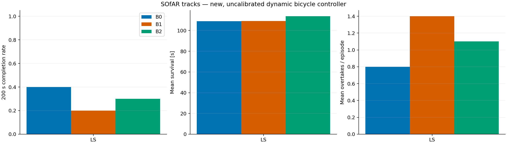
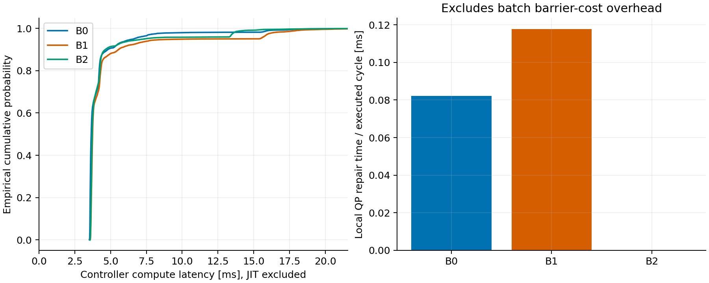
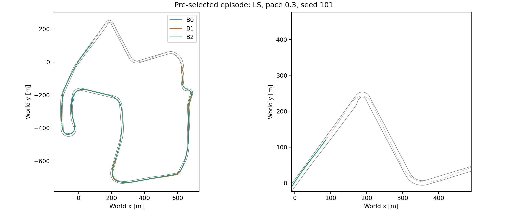

# SOfAR 风格闭环实验：实际运行结果

> 历史 development_v1：此版本后来确认存在对手速度预测、回收后速度一致性及 MIQP 交会目标选择错误。保留原始失败和统计供调试，不能用此结果验证算法收益；有效比较见修复后冻结的 v2 结果。

## 范围与计时边界

实际完成 30 次；每次上限 200.0 s。源码 SHA-256：`e6aaec86bdb01ab52a8f42ce3421d6eaaf0cadee6614e019f3d2effba78f086a`。
这不是作者 acados-MPC / RL 的复现。动力学未标定，速度参考有额外的 39 m/s 上限及提前制动，对手 pace 是原始 raceline 速度倍率。
计时包含控制器规划、采样、筛选与 shield，不包含仿真真值检测/绘图；JIT 已排除。计算延迟没有写回动力学；不是硬实时或严格 CBF 安全证明。

## 汇总（所有失败均保留）

|方法|200 s 完成|碰撞|越界|平均存活 s|总圈数|超车|控制均值 ms|P95 ms|P99 ms|QP 修复均摊 ms|
|---|---:|---:|---:|---:|---:|---:|---:|---:|---:|---:|
|B0|4/10|0|6|108.9|4.72|8|4.23|6.61|16.01|0.082|
|B1|2/10|0|8|109.1|5.61|14|4.68|10.73|17.97|0.118|
|B2|3/10|0|7|113.8|5.49|11|4.38|7.35|14.26|0.000|

延迟来自全部实际周期 pooled 数据，不是 episode P95 的平均。失败方法执行的周期较少、轨迹与状态不同，不能把两组耗时差直接归因为 shield 成本。

## Shield 与保底状态

|方法|修复尝试|修复通过|回退|不可恢复周期|超过 100 ms 周期|
|---|---:|---:|---:|---:|---:|
|B0|440|99|341|163|0 / 10895|
|B1|705|83|622|445|0 / 10914|
|B2|0|0|600|361|0 / 11378|

QP 均摊时间只计事件触发局部修复，未单独测量 rollout 屏障代价开销。`unrecoverable` 表示没找到预测可接受的序列，不等于当步已经碰撞。

## 解释边界

- B0/B1 比较偏置候选方案，包含 APF 与原子候选的共同作用，不能归因于单独一个 APF 分量。
- B1/B2 比较软屏障代价与事件触发修复的组合，不是仅 QP 的单独消融。
- 每个 track/pace 仅五个初始状态，结果用于探索性筛选，未作显著性或真实车辆泛化声明。
- 三组同 seed、同对手策略；回收时间随自车进度变化，因此回收后不保证同一绝对对手轨迹。
- 完成率不能单独代表赛车速度；应与所有 episode 的圈数、超车和存活时间一起阅读。
- 开发试跑及调参失败保留在独立目录，不计入冻结源码的正式样本。

## 图

复现：参见 `experiments/README.md`，逐次原始 CSV 与配置 manifest 一并交付。
