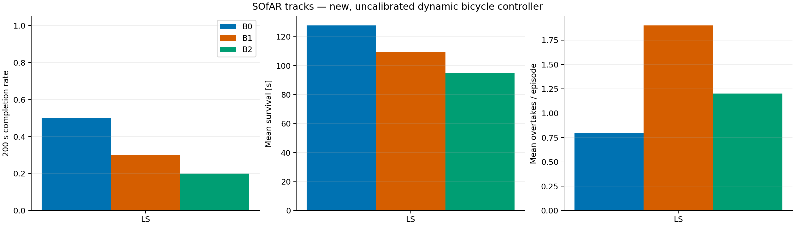
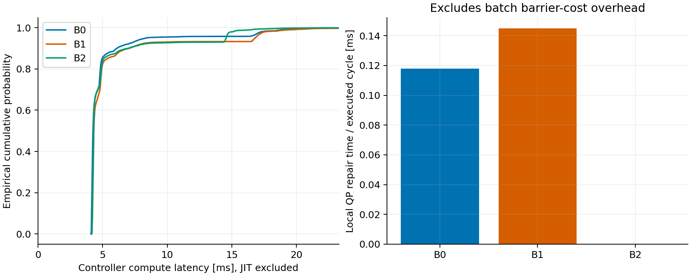
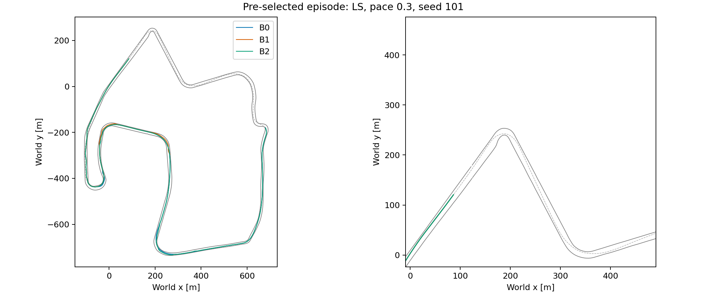

# SOfAR 风格闭环实验：实际运行结果

## 范围与计时边界

实际完成 30 次；每次上限 200.0 s。源码 SHA-256：`e483c71a8931173974f00db8a731a28c9e23e712897b4979e831b4bd92423da4`。
这不是作者 acados-MPC / RL 的复现。动力学未标定，速度参考有额外的 39 m/s 上限及提前制动，对手 pace 是原始 raceline 速度倍率。
计时包含控制器规划、采样、筛选与 shield，不包含仿真真值检测/绘图；JIT 已排除。计算延迟没有写回动力学；不是硬实时或严格 CBF 安全证明。

## 汇总（所有失败均保留）

|方法|200 s 完成|碰撞|越界|平均存活 s|总圈数|超车|控制均值 ms|P95 ms|P99 ms|QP 修复均摊 ms|
|---|---:|---:|---:|---:|---:|---:|---:|---:|---:|---:|
|B0|5/10|0|5|127.7|5.96|8|5.15|8.35|18.82|0.118|
|B1|3/10|0|7|109.2|5.64|19|5.53|16.79|19.41|0.145|
|B2|2/10|1|7|94.9|5.44|12|5.34|14.56|16.47|0.000|

延迟来自全部实际周期 pooled 数据，不是 episode P95 的平均。失败方法执行的周期较少、轨迹与状态不同，不能把两组耗时差直接归因为 shield 成本。
碰撞/越界列为首要终止原因（同时违反时越界优先）。对最终车体独立 SAT 复核的物理接触次数：B0 0 次；B1 0 次；B2 1 次。

## Shield 与保底状态

|方法|修复尝试|修复通过|回退|不可恢复周期|超过 100 ms 周期|
|---|---:|---:|---:|---:|---:|
|B0|797|118|679|473|0 / 12772|
|B1|909|94|815|657|0 / 10923|
|B2|0|0|747|583|0 / 9491|

## 同初始状态配对完成计数

|比较|仅左组完成|仅右组完成|均完成|均失败|
|---|---:|---:|---:|---:|
|B1 vs B0|1|3|2|4|
|B1 vs B2|3|2|0|5|

QP 均摊时间只计事件触发局部修复，未单独测量 rollout 屏障代价开销。`unrecoverable` 表示没找到预测可接受的序列，不等于当步已经碰撞。

## 解释边界

- B0/B1 比较偏置候选方案，包含 APF 与原子候选的共同作用，不能归因于单独一个 APF 分量。
- B1/B2 比较软屏障代价与事件触发修复的组合，不是仅 QP 的单独消融。
- 每个 track/pace 仅五个初始状态，结果用于探索性筛选，未作显著性或真实车辆泛化声明。
- 三组同 seed、同对手策略；回收时间随自车进度变化，因此回收后不保证同一绝对对手轨迹。
- 完成率不能单独代表赛车速度；应与所有 episode 的圈数、超车和存活时间一起阅读。
- 开发试跑及调参失败保留在独立目录，不计入冻结源码的正式样本。
- 真值几何在 0.1 s 执行采样点判断，不是连续时间扫掠碰撞证明。

## 图

复现：参见 `experiments/README.md`，逐次原始 CSV 与配置 manifest 一并交付。数据源是本地产生的 CSV/NPZ，不需要数据库；可复现聚合脚本为 `experiments/report.py`，不是 SQL 查询。
