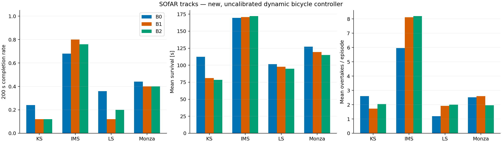
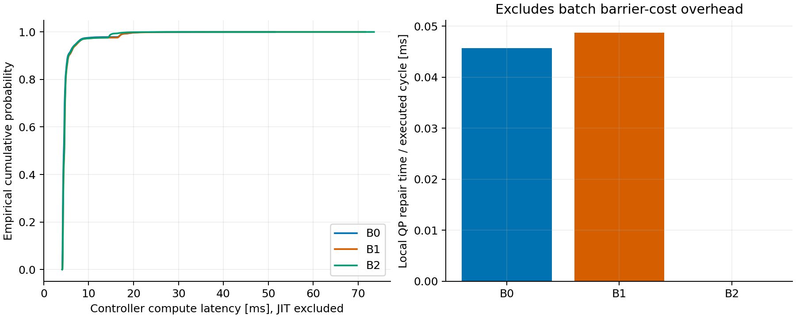
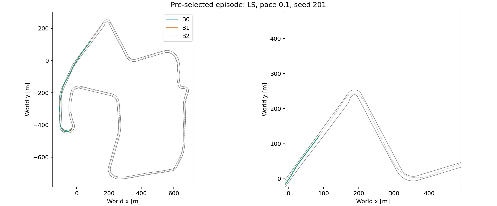

# SOfAR 风格闭环实验：实际运行结果

## 范围与计时边界

实际完成 300 次；每次上限 200.0 s。源码 SHA-256：`e483c71a8931173974f00db8a731a28c9e23e712897b4979e831b4bd92423da4`。
这不是作者 acados-MPC / RL 的复现。动力学未标定，速度参考有额外的 39 m/s 上限及提前制动，对手 pace 是原始 raceline 速度倍率。
高 pace 档的对手在部分赛道/路段可能快于自车目标速度上限，对这些档次不能预设必能超车；完成率也不等于超车性能。
计时包含控制器规划、采样、筛选与 shield，不包含仿真真值检测/绘图；JIT 已排除。计算延迟没有写回动力学；不是硬实时或严格 CBF 安全证明。

## 汇总（所有失败均保留）

|方法|200 s 完成|碰撞|越界|平均存活 s|总圈数|超车|控制均值 ms|P95 ms|P99 ms|QP 修复均摊 ms|
|---|---:|---:|---:|---:|---:|---:|---:|---:|---:|---:|
|B0|43/100|8|49|127.6|108.44|307|4.96|7.19|17.35|0.046|
|B1|36/100|9|55|117.2|98.67|359|5.08|7.41|17.29|0.049|
|B2|37/100|6|57|115.1|95.78|355|4.99|7.23|14.99|0.000|

## 分赛道（不以总体均值掩盖失败）

|赛道|方法|完成|碰撞终止|越界终止|平均存活 s|超车总数|
|---|---|---:|---:|---:|---:|---:|
|KS|B0|6/25|7|12|112.2|65|
|KS|B1|3/25|4|18|81.1|43|
|KS|B2|3/25|3|19|78.5|51|
|IMS|B0|17/25|0|8|169.5|149|
|IMS|B1|20/25|1|4|170.6|203|
|IMS|B2|19/25|0|6|172.1|205|
|LS|B0|9/25|0|16|101.4|30|
|LS|B1|3/25|2|20|97.8|48|
|LS|B2|5/25|1|19|94.9|50|
|Monza|B0|11/25|1|13|127.3|63|
|Monza|B1|10/25|2|13|119.3|65|
|Monza|B2|10/25|2|13|115.0|49|

## 本次观察（不是成功预设）

完整方法 B1 完成 36/100，基线 B0 完成 43/100；未观察到整体安全完成率优于基线，不能宣称 APF 方案已经有效。
B1 / B2 完成数为 36/100 / 37/100，末态物理接触为 9 / 6 次。这是屏障代价加局部修复的组合比较；只有开销小不等于已验证安全收益，不能把原理预期当作本批结论。
动力学和跟踪未标定，失败终止原因、末态与不可恢复周期只能用于定位问题，不能据此断言单一失效原因。下一步优先验证无障碍跟踪和车辆参数，而不是继续增加方法组。

延迟来自全部实际周期 pooled 数据，不是 episode P95 的平均。失败方法执行的周期较少、轨迹与状态不同，不能把两组耗时差直接归因为 shield 成本。
碰撞/越界列为首要终止原因（同时违反时越界优先）。对最终车体独立 SAT 复核的物理接触次数：B0 8 次；B1 9 次；B2 6 次。

## Shield 与保底状态

|方法|修复尝试|修复通过|回退|不可恢复周期|超过 100 ms 周期|
|---|---:|---:|---:|---:|---:|
|B0|3281|321|2960|2431|0 / 127620|
|B1|3266|317|2949|2487|0 / 117181|
|B2|0|0|2880|2440|0 / 115146|

高层 MIQP 规划调用 pooled 均值 / P95（ms，含无活跃对手时的快速返回）：B0 0.51 / 2.01；B1 0.54 / 2.01；B2 0.54 / 2.01。
最大控制周期（ms）：B0 51.46；B1 71.56；B2 73.53。

## 同初始状态配对完成计数

|比较|仅左组完成|仅右组完成|均完成|均失败|
|---|---:|---:|---:|---:|
|B1 vs B0|5|12|31|52|
|B1 vs B2|5|6|31|58|

QP 均摊时间只计事件触发局部修复，未单独测量 rollout 屏障代价开销。`unrecoverable` 表示没找到预测可接受的序列，不等于当步已经碰撞。

## 解释边界

- B0/B1 比较偏置候选方案，包含 APF 与原子候选的共同作用，不能归因于单独一个 APF 分量。
- B1/B2 比较软屏障代价与事件触发修复的组合，不是仅 QP 的单独消融。
- 每个 track/pace 仅五个初始状态，结果用于探索性筛选，未作显著性或真实车辆泛化声明。
- 三组同 seed、同对手策略；回收时间随自车进度变化，因此回收后不保证同一绝对对手轨迹。
- 完成率不能单独代表赛车速度；应与所有 episode 的圈数、超车和存活时间一起阅读。
- 开发试跑及调参失败保留在独立目录，不计入冻结源码的正式样本。
- 真值几何在 0.1 s 执行采样点判断，不是连续时间扫掠碰撞证明。
- 固定种子与配置不等于跨硬件位级复现；Gurobi 墙钟时限可能影响边缘情形的可行解。

## 图

复现：参见 `experiments/README.md`，逐次原始 CSV 与配置 manifest 一并交付。数据源是本地产生的 CSV/NPZ，不需要数据库；可复现聚合脚本为 `experiments/report.py`，不是 SQL 查询。
